# EDGEGUARD AI — Captured Output

Production build served by FastAPI, captured with headless Chrome on 2026-11-10.

> **Synthetic demonstration only.** The dataset is explicitly named `SYNTHETIC_DEMO_NOT_RESEARCH_DATA`. It is a small, highly separable generated fixture used to exercise the real pipeline. The perfect metrics below validate plumbing, not model quality, and are **not research results**. No real Kaggle dataset was imported for these screenshots.

## Screenshots

### Command Center
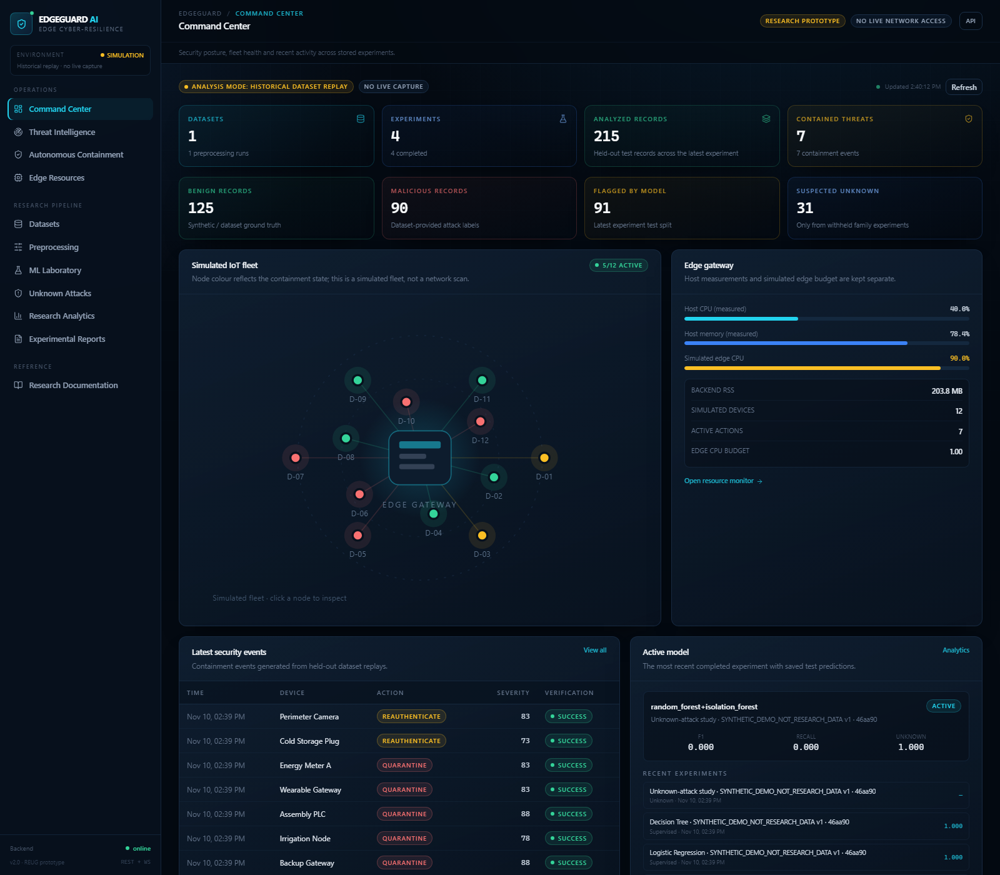

### Dataset Management
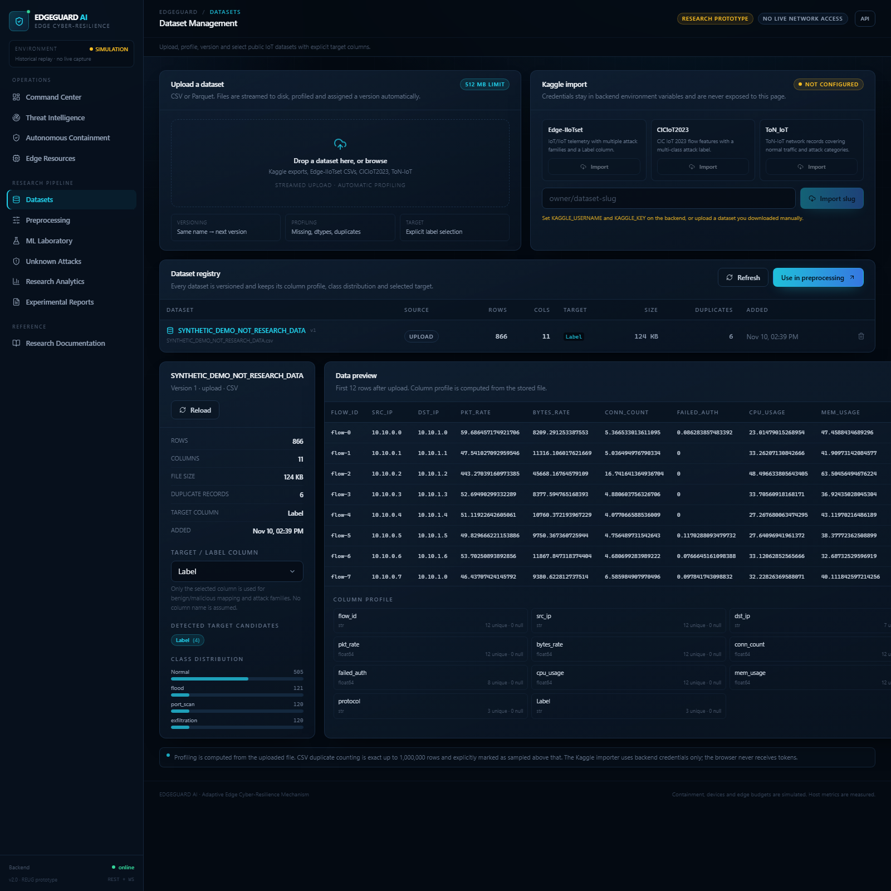

### Data Preprocessing
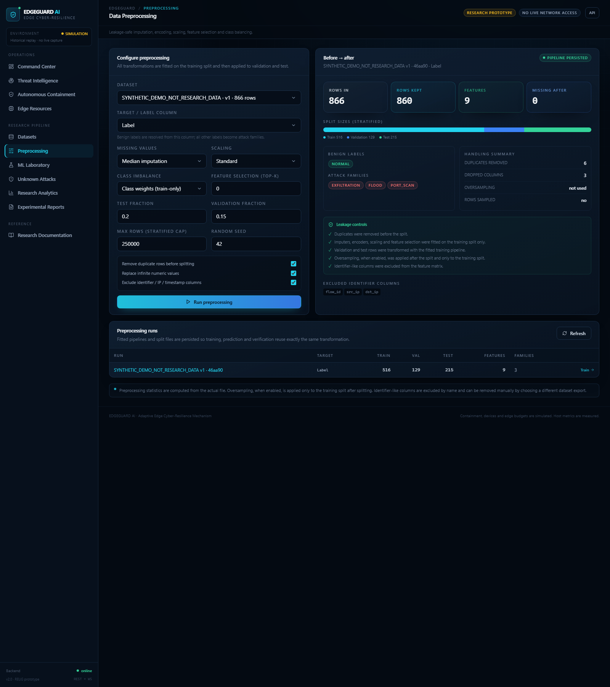

### ML Model Laboratory
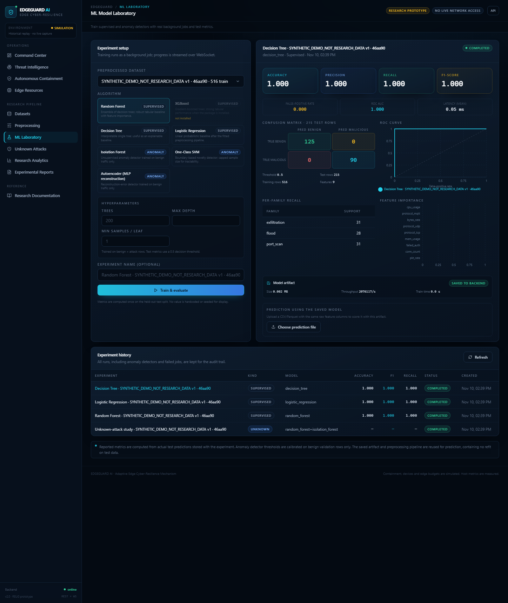

### Unknown Attack Detection
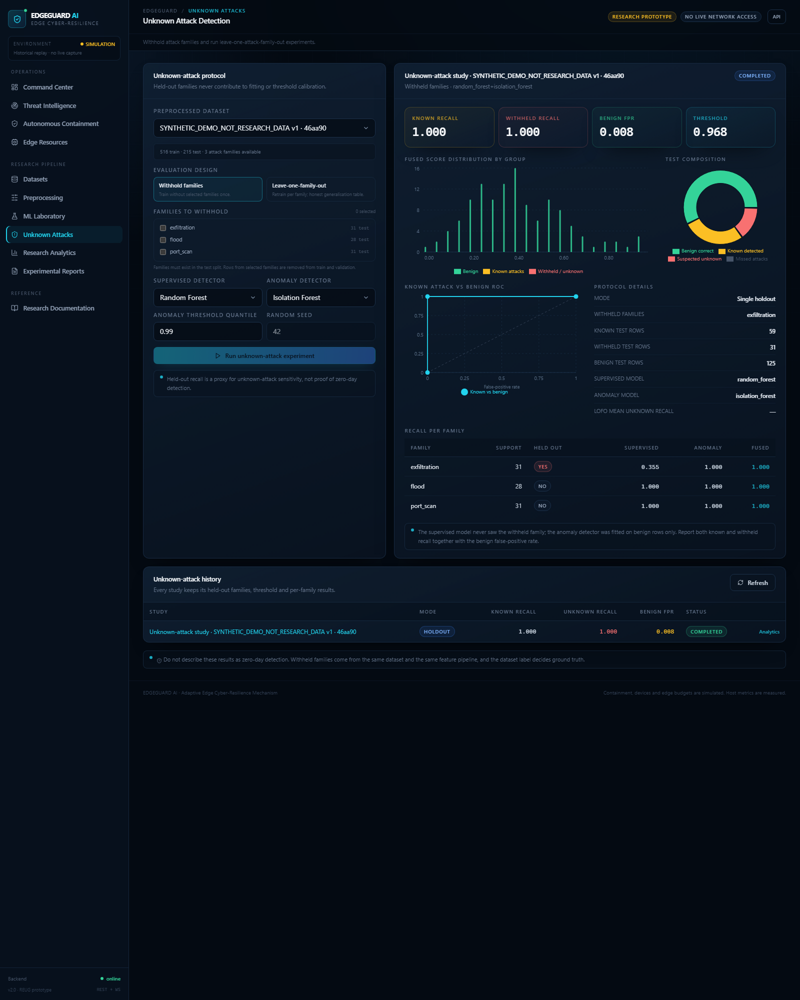

### Threat Intelligence
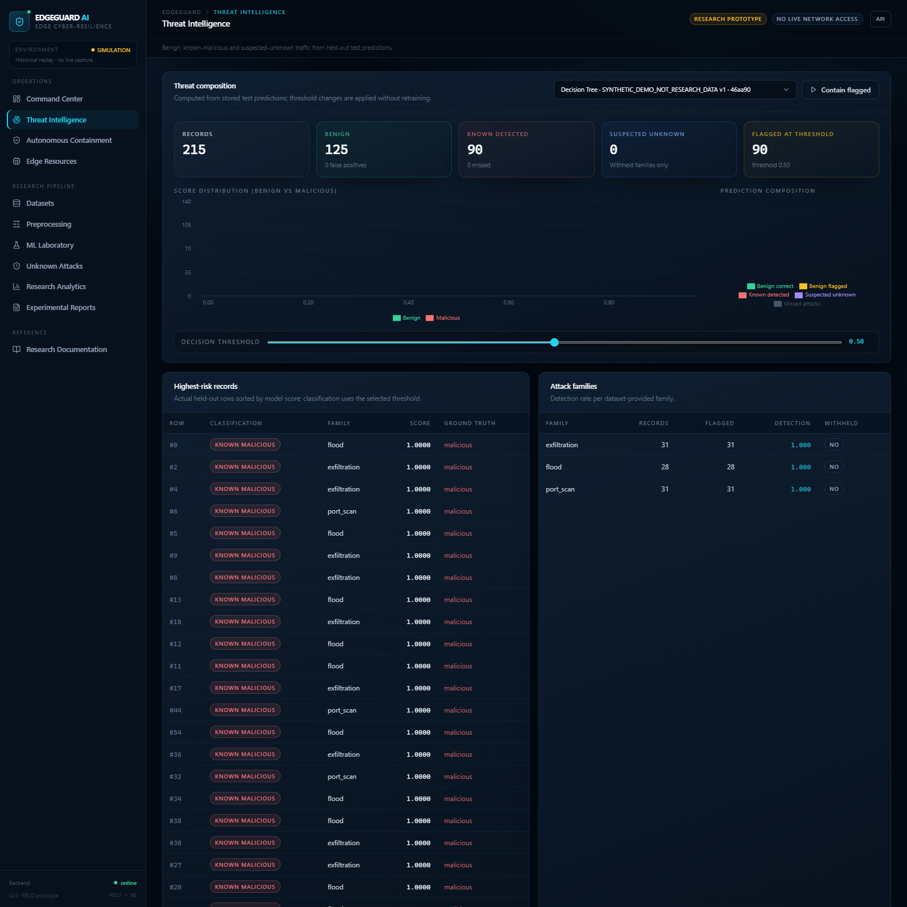

### Autonomous Containment
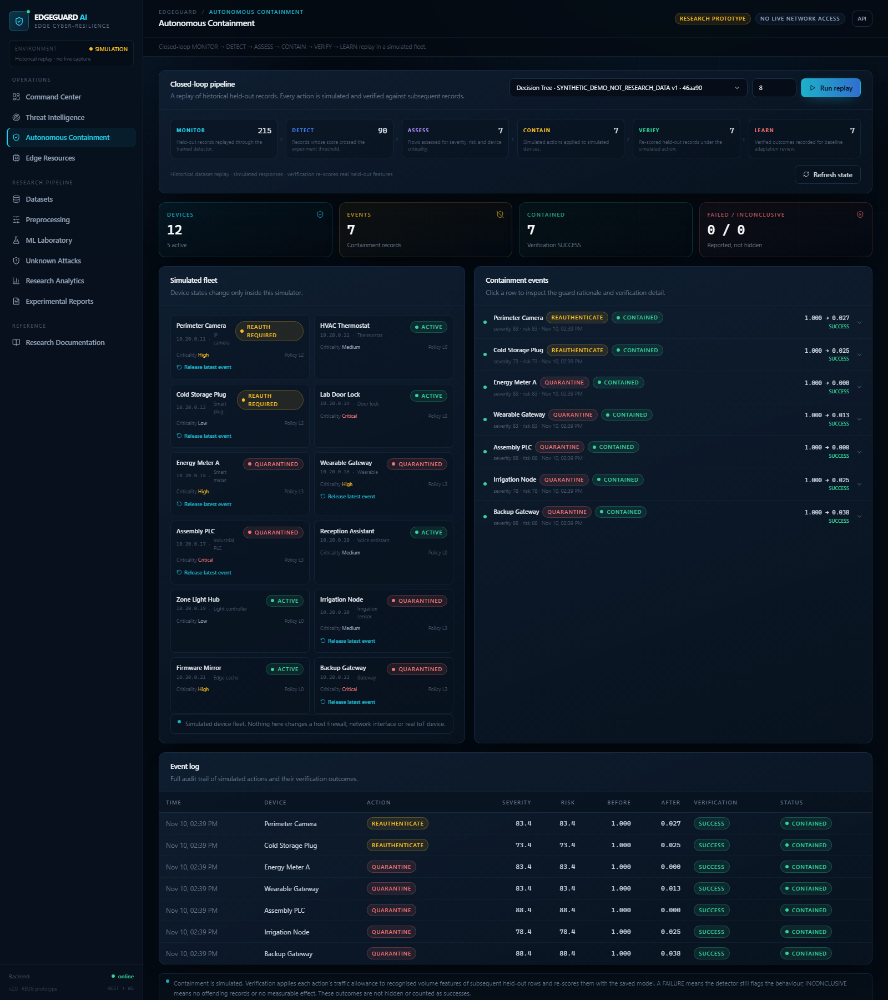

### Edge Resource Monitoring
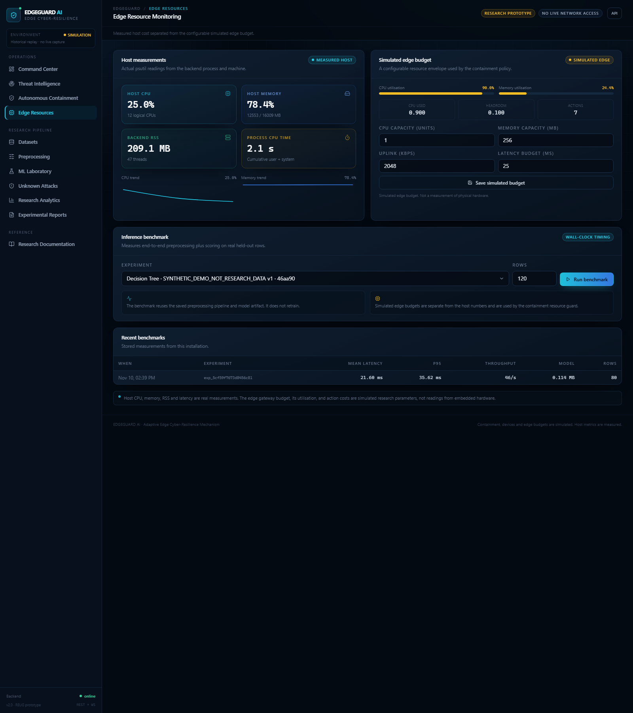

### Research Analytics
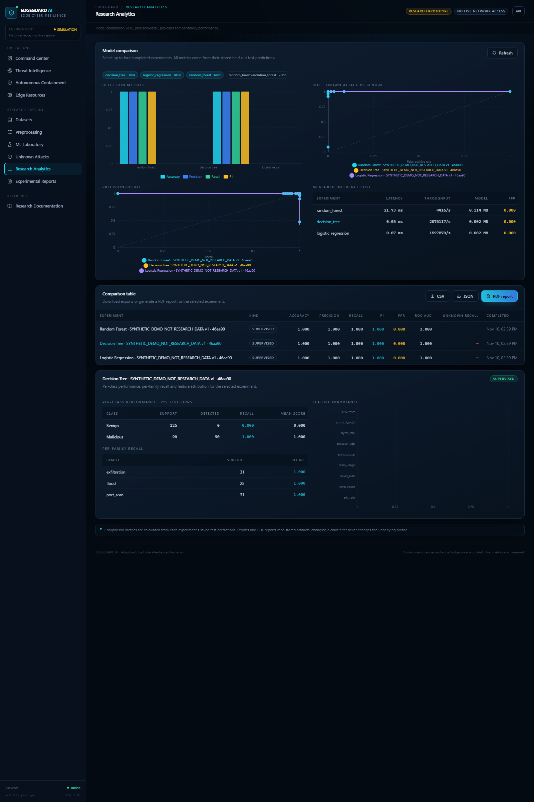

### Experimental Reports
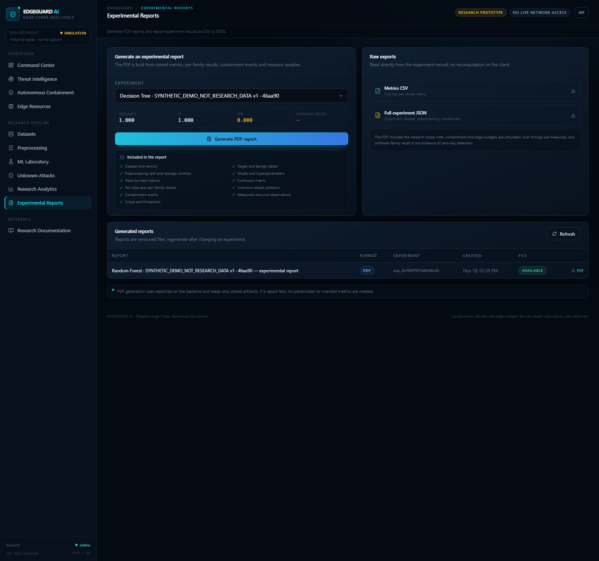

### Research Documentation
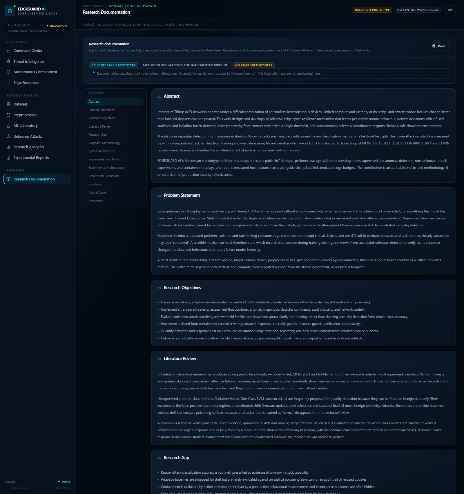

## Verified Demo Results

This run used a generated fixture explicitly named **`SYNTHETIC_DEMO_NOT_RESEARCH_DATA`**.

| Item | Result |
|---|---|
| Dataset | 866 rows, 11 columns, 6 duplicates |
| Class distribution | Normal 505, flood 121, port_scan 120, exfiltration 120 |
| Preprocessing | 860 rows kept, 9 features, 516 train / 129 validation / 215 test |
| Identifiers removed | `flow_id`, `src_ip`, `dst_ip` |
| Random Forest | Accuracy 1.000, Precision 1.000, Recall 1.000, F1 1.000, ROC AUC 1.000 |
| Inference | 21.73 ms mean, 30.78 ms p95, 4,416 records/s, 0.114 MB model |
| Unknown holdout | `exfiltration` withheld; known recall 1.000, withheld recall 1.000, benign FPR 0.008 |
| Containment | 7 replay events, all SUCCESS |
| Pipeline | MONITOR 215 → DETECT 90 → ASSESS 7 → CONTAIN 7 → VERIFY 7 → LEARN 7 |
| Resources | Host CPU/memory measured separately from the simulated edge budget |
| Command Center | 1 dataset, 4 experiments, 215 analyzed records, 90 malicious, 7 contained |
| Reports | 3-page PDF, metrics CSV, full experiment JSON |

## Seed Script

The reproducible seeder at `artifacts/seed_showcase.py` runs the full API workflow through the real backend. Recreate the demo:

```bash
cd Cyber_Resilience_or-Resource-Constrained-IoT-main
python artifacts/seed_showcase.py
```

## Verification

- `python -m pytest backend/tests -q` — **12 passed** in 10.60 s
- `cd frontend && npm test` — **6 passed** in 2 files
- `cd frontend && npm run build` — **success** in 4.58 s
- `python -m pytest tests -q` (preserved legacy suite) — **78 passed** in 33.85 s
- All 11 routes + `/api/health`: **HTTP 200**

## Reproduction

```bash
# Serve the populated demo
EDGEGUARD_DATA_DIR="$PWD/data/showcase" \
  uvicorn backend.main:app --host 127.0.0.1 --port 8000
# Then open http://127.0.0.1:8000

# Normal clean start (no data dir)
uvicorn backend.main:app --host 127.0.0.1 --port 8000
```