# EDGEGUARD AI — Captured Output

Production build served by FastAPI, captured with headless Chrome on 2026-11-10.

> **Synthetic demonstration only.** The dataset is explicitly named `SYNTHETIC_DEMO_NOT_RESEARCH_DATA`. It is a small, highly separable generated fixture used to exercise the real pipeline. The perfect metrics below validate plumbing, not model quality, and are **not research results**. No real Kaggle dataset was imported for these screenshots.

## Screenshots

### Command Center
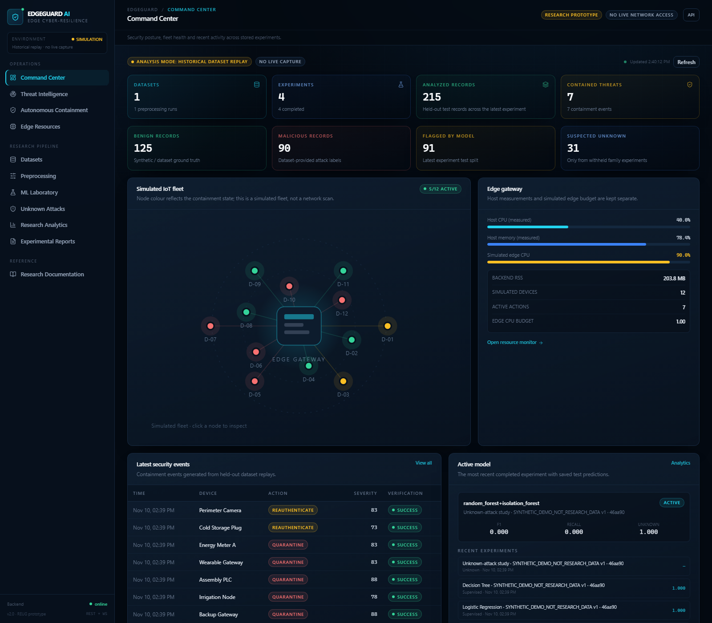

### Dataset Management
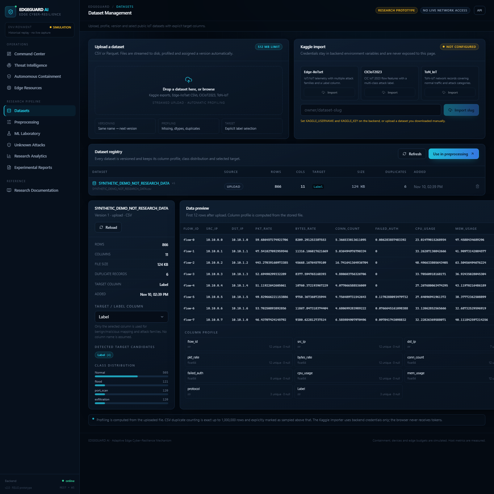

### Data Preprocessing
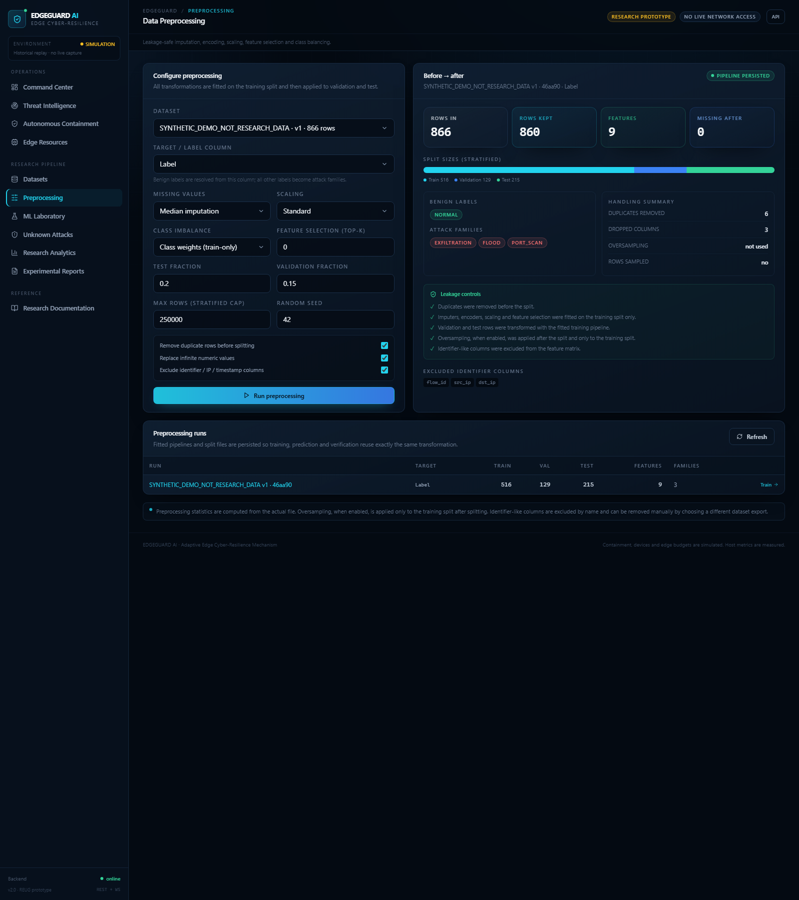

### ML Model Laboratory
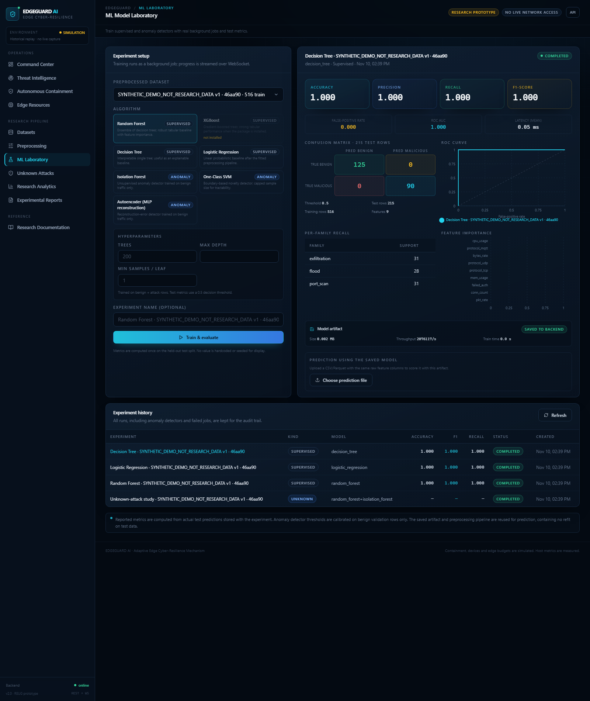

### Unknown Attack Detection
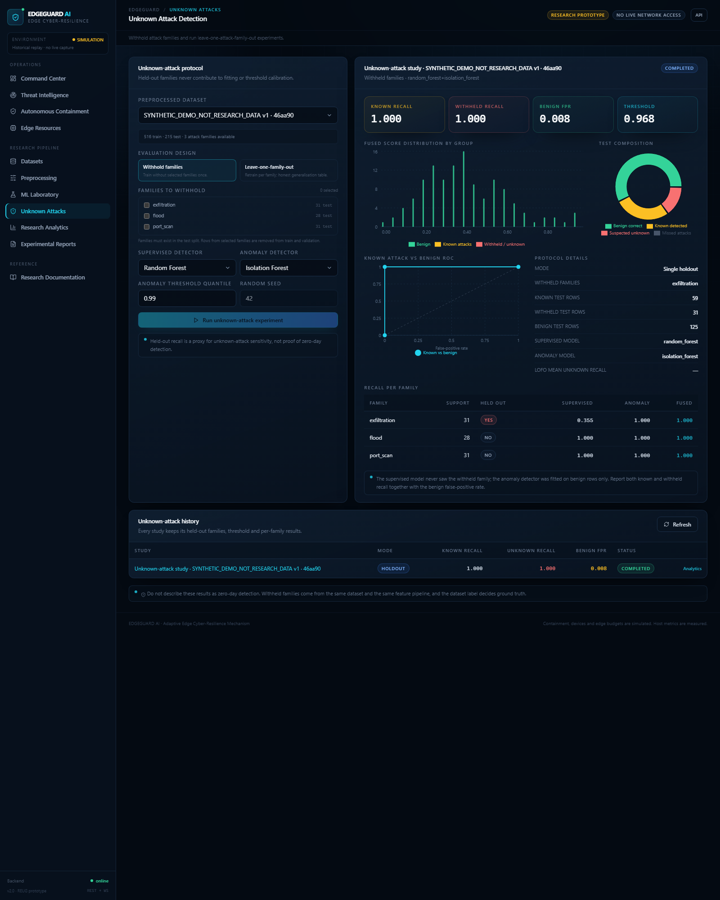

### Threat Intelligence
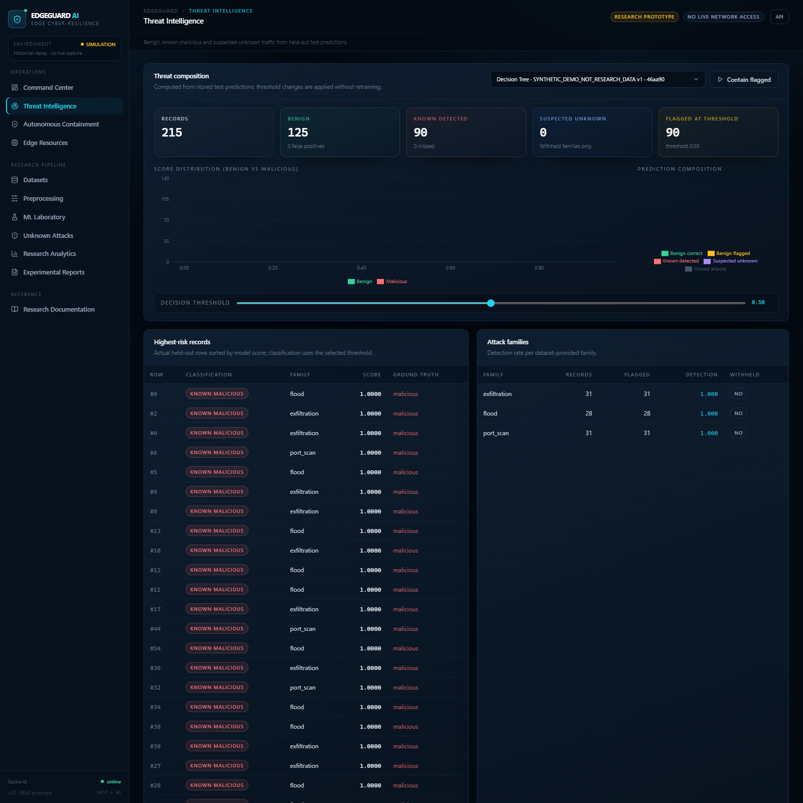

### Autonomous Containment
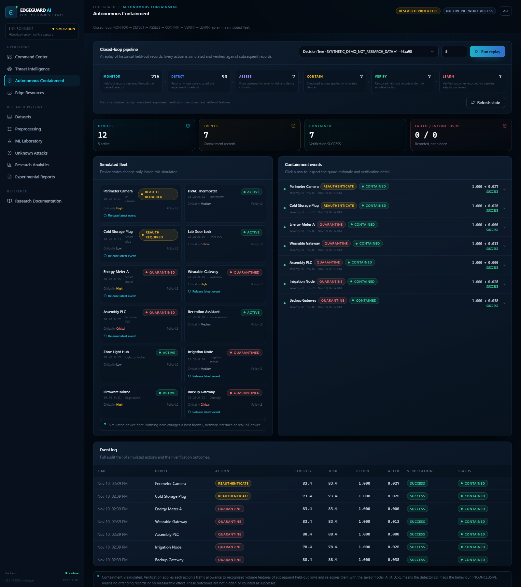

### Edge Resource Monitoring
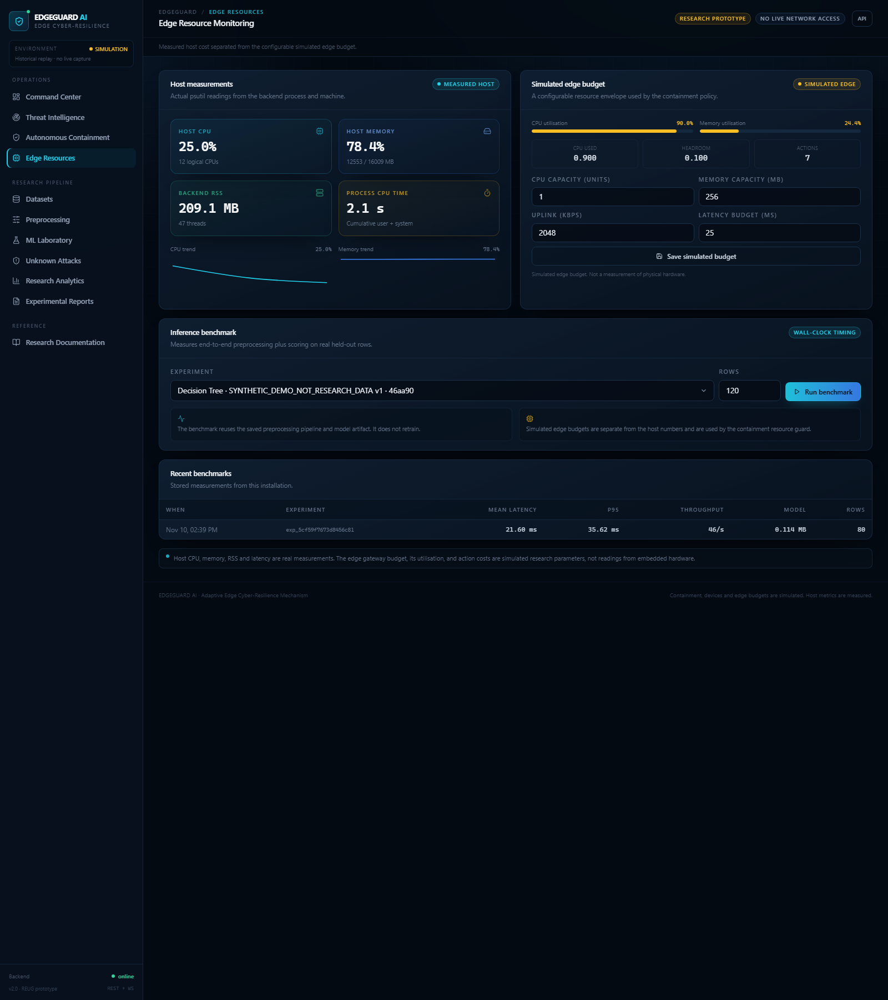

### Research Analytics
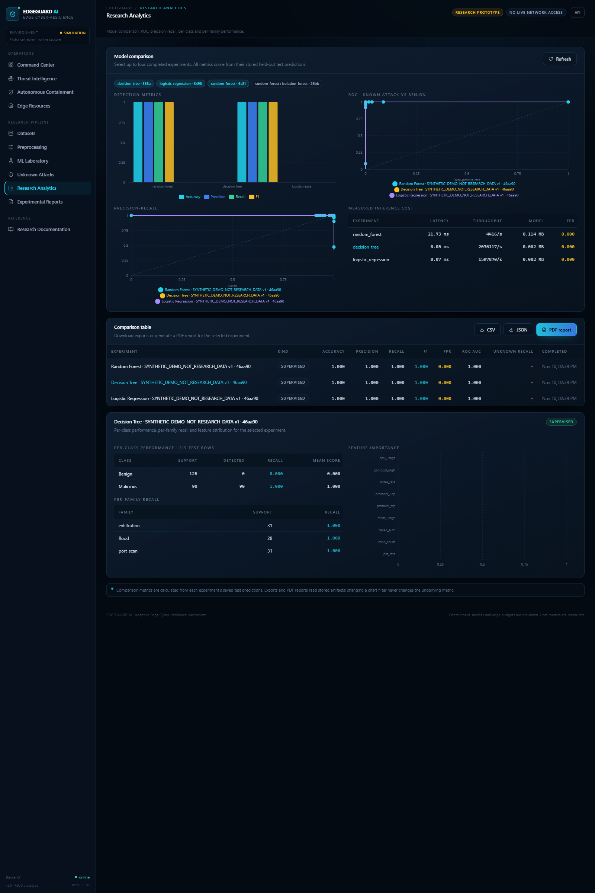

### Experimental Reports
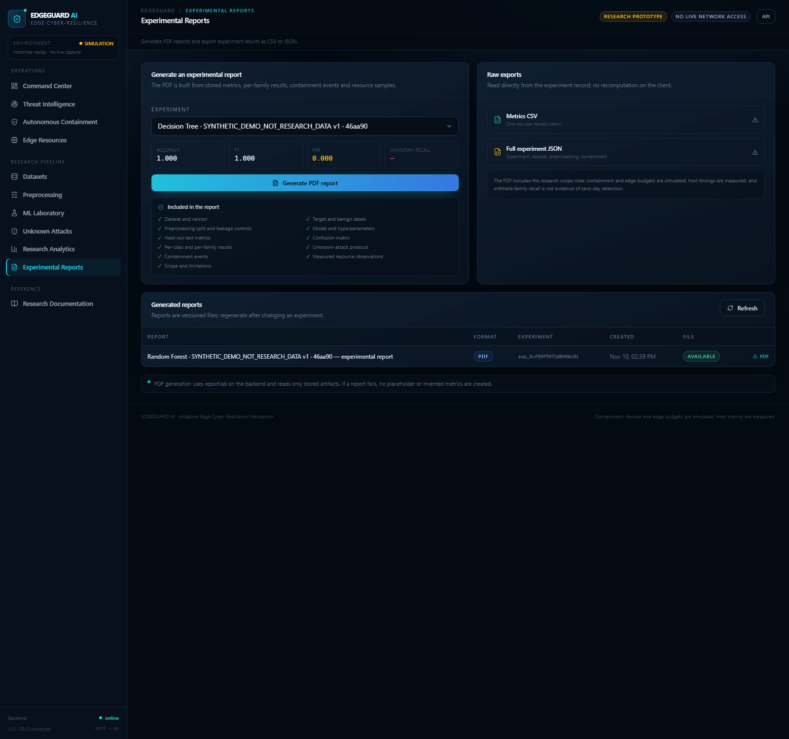

### Research Documentation
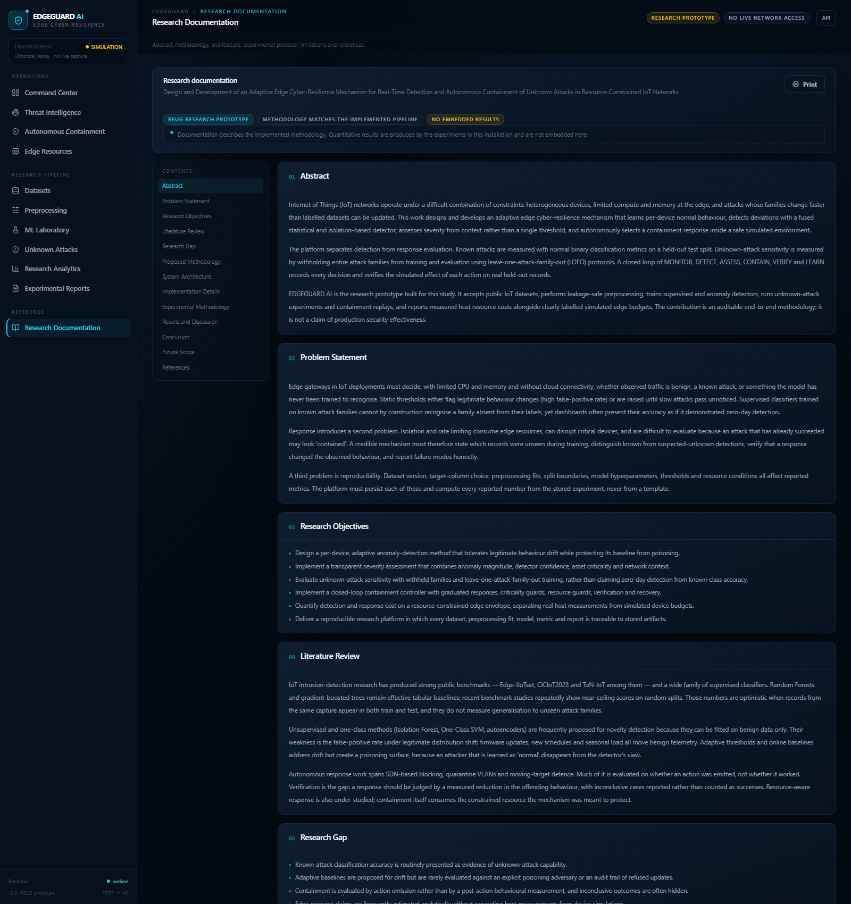

## Verified demo results

| Item | Output |
|---|---|
| Dataset | 866 rows, 11 columns, 6 duplicates; Normal 505 / flood 121 / port_scan 120 / exfiltration 120 |
| Preprocessing | 860 rows kept, 9 features; 516 train / 129 validation / 215 test; `flow_id`, `src_ip`, `dst_ip` excluded |
| Random Forest | Accuracy 1.000, Precision 1.000, Recall 1.000, F1 1.000, ROC AUC 1.000; 215 test rows |
| Inference | 21.73 ms mean, 30.78 ms p95, 4,416 records/s, 0.114 MB model |
| Unknown-family holdout | Withheld `exfiltration`; known recall 1.000, withheld recall 1.000, benign FPR 0.008, threshold 0.968 |
| Containment | 7 replay events, 7 SUCCESS; actions REAUTHENTICATE and QUARANTINE |
| Pipeline | MONITOR 215 · DETECT 90 · ASSESS 7 · CONTAIN 7 · VERIFY 7 · LEARN 7 |
| Resources | Host CPU/memory measured separately from the simulated edge budget (1 CPU unit, 256 MB, 2048 kbps, 25 ms) |
| Command Center | 1 dataset, 4 experiments, 215 analyzed records, 90 malicious, 7 contained; fleet health 41.7% after 7 quarantines |
| PDF report | 3 pages, 7.0 KB |

Perfect metrics are expected here because the synthetic fixture is nearly linearly separable. They demonstrate that preprocessing, training, held-out scoring, unknown-family evaluation, containment verification, and report generation execute end-to-end.

## Artifacts

- [PDF report](showcase-report.pdf)
- [Extracted report text](showcase-report.txt)
- [Metrics CSV](showcase-metrics.csv)
- [Full experiment JSON](showcase-metrics.json)
- [Demo summary JSON](showcase-summary.json)
- [Seed script](seed_showcase.py)

## Reproduction

```bash
# Recreate the synthetic demo database and exports
python artifacts/seed_showcase.py

# Serve the populated demo
EDGEGUARD_DATA_DIR="$PWD/data/showcase" \
  uvicorn backend.main:app --host 127.0.0.1 --port 8000
```

Open `http://127.0.0.1:8000`. The normal application start (without `EDGEGUARD_DATA_DIR`) uses `data/edgeguard` and begins empty.

## Verification

- Backend platform suite: **12 passed**.
- Frontend suite: **6 passed**.
- Preserved legacy suite: **78 passed**.
- Production build: success.
- All 11 routes served with HTTP 200; API and SPA fallback verified.
- Analytics comparison table mapping was corrected during this capture and rebuilt.
